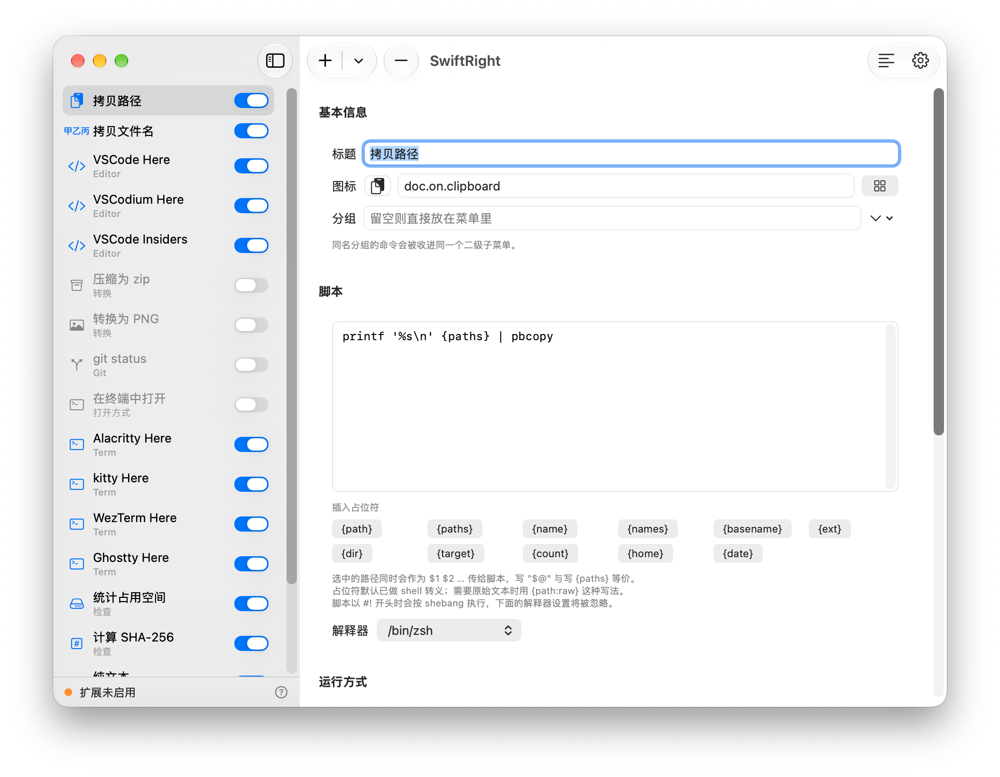

# SwiftRight

[简体中文](README.zh-CN.md)

> Vibe-coded with Claude Opus 5.

A Finder context-menu extension for macOS. Define any shell command in a GUI and it shows up when you right-click, acting on whatever is selected.

Built with Swift / SwiftUI / Xcode. No third-party dependencies.




---

## Install

### From a release build

Download `SwiftRight-<version>.dmg` (or `.zip`) from [Releases](https://github.com/WHYBBE/SwiftRight/releases), drag **SwiftRight.app** into **Applications**, then:

```bash
xattr -dr com.apple.quarantine /Applications/SwiftRight.app
```

**That command is not optional.** The builds are ad-hoc signed and not notarized — see [Gatekeeper](#gatekeeper) below for why, and for what happens if you skip it.

### From source

```bash
swift Scripts/make-icon.swift   # optional: generate the app icon
./Scripts/build.sh              # generate project → build → install to /Applications → register
```

Locally built copies are signed with your own certificate and never quarantined, so no `xattr` step is needed.

Build without installing: `./Scripts/build.sh build`
Package a distributable: `./Scripts/package.sh` → `dist/` (zip + dmg, ad-hoc signed)
Develop in Xcode: `open SwiftRight.xcodeproj` (the project file is committed; `xcodegen` is only needed to regenerate it)

### Then, either way

1. Open `/Applications/SwiftRight.app` once
2. **System Settings › General › Login Items & Extensions › Finder extensions** — enable **SwiftRight**
3. Right-click anything in Finder

By default the app lives in the menu bar (no Dock icon). Click its icon → **Manage Commands…**

**Does the app need to stay running?** No. The Finder extension is a separate process that reads the config directly; clicking a menu item launches the app on demand — measured at ~0.29 s cold versus ~0.18 s warm. If you'd rather it not stay resident, **Settings › General › Background** offers *Quit when idle*. The only hard requirement is opening the app once after installing, so it can write its initial config.

---

## Gatekeeper

Release builds are **ad-hoc signed and not notarized**, so macOS quarantines them on download and refuses to open them:

> "SwiftRight" is damaged and can't be opened.

That message is misleading — nothing is damaged. It is what Gatekeeper says about any app that carries a quarantine flag and no Developer ID signature. Removing the flag is enough:

```bash
xattr -dr com.apple.quarantine /Applications/SwiftRight.app
```

Skipping it also breaks the Finder extension silently: a quarantined bundle never gets registered, so no context menu appears and there is nothing to enable in System Settings.

Files transferred by AirDrop, USB or a local share are not quarantined, so those copies open straight away.

**Why not just notarize it?** Notarization requires a paid Apple Developer Program membership ($99/year) for a Developer ID certificate. Until then, ad-hoc signing is the honest alternative — and it has one advantage over signing with a development certificate: ad-hoc signatures carry no certificate, so they never expire. A development certificate lasts a year, and Xcode only requests a secure timestamp for Developer ID signatures, so a development-signed binary stops validating once the certificate lapses.

---

## Architecture

```
Finder ──right-click──▶ FinderExtension.appex  (sandboxed)
                        │  reads commands.json, builds the menu
                        │  on click: writes a ticket, opens swiftright://run?ticket=…
                        ▼
                 SwiftRight.app                (not sandboxed)
                        │  looks up the ticket → expands placeholders → Process
                        ▼
                 background / output window / terminal
```

**Why two processes?**

App extensions are sandboxed by the system, and inside that sandbox `Process` cannot launch anything external — which is the entire point of this tool. So the extension only builds menus; execution lives in the non-sandboxed host app.

The two sides communicate through `~/Library/Application Support/SwiftRight/`:

| File | Purpose |
|---|---|
| `commands.json` | Command definitions. Written by the app, read by the extension (mtime-cached, so edits apply on the next right-click — no need to restart Finder) |
| `pending/<uuid>.json` | One-shot invocation ticket. Written by the extension, consumed and deleted by the app |
| `scratch/` | Temporary `.command` scripts for terminal mode |

The extension reaches that one directory via a `temporary-exception.files.home-relative-path.read-write` entitlement, scoped to SwiftRight's own folder. **No App Group is used**, so no paid developer account is required.

Paths travel through a file rather than the URL: a multi-selection of long paths overflows a URL quickly, and percent-encoding path characters is error-prone.

Matching logic in `Shared/` compiles into both targets, so what the menu shows and what can actually run never diverge.

---

## Placeholders

Placeholders are **shell-quoted by default**, so paths with spaces, quotes or `$` are safe. Append `:raw` for the unescaped text (e.g. `{paths:raw}`).

| Placeholder | Meaning |
|---|---|
| `{path}` | Full path of the first selected item |
| `{paths}` | All selected items, space-separated |
| `{name}` | File name, with extension |
| `{names}` | All file names |
| `{basename}` | File name, without extension |
| `{ext}` | Extension, without the dot |
| `{dir}` | Containing folder |
| `{target}` | The folder of the current Finder window |
| `{count}` | Number of selected items |
| `{home}` | Home directory |
| `{date}` | Timestamp, `yyyyMMdd-HHmmss` |

Selected paths are **also** passed as positional arguments, so these are equivalent:

```bash
zip -r out.zip {paths}
zip -r out.zip "$@"
```

Environment variables are set too: `SR_PATH` `SR_PATHS` (newline-separated) `SR_DIR` `SR_TARGET` `SR_NAME` `SR_BASENAME` `SR_EXT` `SR_COUNT` `SR_HOME`.

A script starting with `#!` is written to a temporary executable and run via its shebang, ignoring the configured interpreter — so you can write Python, Ruby or AppleScript directly.

GUI processes inherit a narrow `PATH`, so `/opt/homebrew/bin` and `/usr/local/bin` are appended before running. Homebrew-installed tools just work.

---

## Command options

- **Execution** — silent background / live output window (streaming stdout+stderr) / hand off to a terminal
- **Working directory** — folder containing the selection / the selected folder itself / current Finder window / custom (placeholders allowed)
- **Scope** — files only / folders only / both, plus an extension filter. Commands that don't match simply don't appear in the menu
- **Group** — commands sharing a group name collapse into a submenu
- **Run once per item** — spawn a process per selected file instead of passing them all at once
- **Confirm before running** / **notify when finished** / **timeout** (seconds, 0 = none)
- Globally switchable: commands flat in the context menu, or collected under one submenu

**Test Run** in the editor opens a file picker to stand in for the selection, runs once and shows the output — no switching to Finder to iterate.

Failed background commands open the output window by default; otherwise silent failures are hard to diagnose (switchable in settings).

---

## Generators

The toolbar `+` menu and the settings window can generate commands for you.

**Terminals.** Scans for installed terminals and generates *Open kitty here* style commands. Every terminal disagrees on command-line conventions, so launch recipes are built in and verified against each one's `--help`:

| Terminal | Arguments |
|---|---|
| Terminal / iTerm2 | `open -a <App> <script>` |
| kitty | `--directory {dir} {shell} {script}` |
| WezTerm | `start --cwd {dir} -- {shell} {script}` |
| Ghostty | `--working-directory={dir} -e {shell} {script}` |
| Rio | `--working-dir {dir} -e {shell} {script}` |
| Alacritty | `--working-directory {dir} -e {shell} {script}` |

Discovery beyond the built-in list filters on `CFBundleTypeRole == "Shell"` — apps declaring they *execute* shell scripts. Asking LaunchServices "who can open a shell script" instead pulls in Chrome, Notes, Pages and every text editor.

kitty, WezTerm, Ghostty and Rio close the window as soon as the command exits, so short commands flash past. **Keep the terminal open** (on by default) appends an interactive shell and prints the exit code.

**Editors.** Scans for installed editors and generates *Open Zed here* style commands. Unlike terminals these need no per-app recipe — `open -b <bundle id> <path>` works everywhere, and opening by bundle id survives the app being updated or moved.

The one thing recorded per editor is whether it can open a folder as a project, which decides whether the command applies to folders. This cannot be read from `Info.plist`: VS Code, Zed and VSCodium declare `public.folder`, but the JetBrains IDEs and Qt Creator do not — yet all of them support it.

**File templates.** Right-click a folder → **New File ▸** with a template, like Windows Explorer's *New*. Ships with Plain Text, Markdown, JSON, HTML, CSS, JavaScript, YAML, XML, Shell Script and Python; the last two get the executable bit. Name, default file name, extension, icon and initial contents are all editable, and you can add your own.

The generated command is an ordinary script using a heredoc, so it stays readable and editable. Name collisions increment the way Finder does (`Untitled 2.md`). Afterwards the new file is revealed and selected in Finder — press Return to rename.

---

## Settings

Open from the menu bar icon, or ⌘,

- **General** — language (System / 简体中文 / English, applied instantly), theme (System / Light / Dark), how the app stays in the background, whether a failed background command opens the output window
- **Menu** — context menu appearance
- **Terminal** — scan, add manually, pick the default, adjust launch arguments per terminal, test one, keep the terminal open after a command finishes
- **Editors** — scan, add manually, toggle folder support, add to menu
- **New File** — manage templates
- **Configuration** — export / import (append or replace), file location, restore examples
- **Extension** — status and troubleshooting

### Background

The Finder extension is sandboxed and cannot spawn external processes, so a non-sandboxed process has to execute commands. "Not resident" therefore means "cold launch every time" — there is no third option. **Settings › General › Background** picks where on that trade-off you sit:

| Mode | Menu bar icon | Response | Leaves a process |
|---|---|---|---|
| **Stay in menu bar** (default) | yes | fastest | yes |
| **Stay running, hide icon** | no | fastest | yes |
| **Quit when idle** | no | ~0.08 s slower | no |

*Quit when idle* waits until nothing is running and no window is open before exiting, so a long background command is never cut short.

With the icon hidden, open the interface by double-clicking SwiftRight in Applications.

---

## Troubleshooting

**Nothing appears in the context menu**

1. If you downloaded a release build, did you remove the quarantine flag? A quarantined bundle is never registered — see [Gatekeeper](#gatekeeper)
2. Is the app in `/Applications` and has it been opened at least once? Only then does the system register the extension
3. Is SwiftRight enabled in System Settings? (the app's sidebar has a live status light)
4. `killall Finder`

The **?** button at the bottom of the sidebar jumps to the same tools.

**Do I need to restart Finder after editing a command?**

No. The extension checks `commands.json`'s modification time on every right-click.

**Signing**

`DEVELOPMENT_TEAM` in `project.yml` needs to be your own team ID:

```bash
security find-identity -v -p codesigning
```

Note that the ten characters in parentheses of the certificate's common name are the *certificate* ID, not the team ID — read the `OU` field instead.

---

## Layout

```
project.yml                  XcodeGen definition (the .xcodeproj is committed too)
Shared/                      compiled into both the app and the extension
  SRCommand.swift              command model + menu matching
  SRConfigStore.swift          commands.json I/O + built-in examples
  SRPaths.swift                real paths, bypassing the sandbox container
  SRPlaceholder.swift          placeholder expansion + shell quoting
  SRTicket.swift               one-shot extension → app ticket
App/                         host app (not sandboxed)
  SwiftRightMain.swift         entry point, menu bar, URL callback, background residency
  SRCommandRunner.swift        Process execution, environment, timeout, terminal modes
  SRRunSession.swift           observable state of one run + incremental UTF-8 decoding
  SRAppModel.swift             UI data source and command generators
  SRPreferences.swift          language / theme / residency / localization
  SRWindowManager.swift        windows and the .accessory ⇄ .regular activation policy
  SRTerminal*.swift            terminal catalog and launch recipes
  SREditor*.swift              editor catalog
  SRFileTemplate.swift         new-file templates
  SRTemplateStore.swift        template persistence
  Views/                       SwiftUI, including the settings and about windows
FinderExtension/             Finder extension (sandboxed)
  FinderSync.swift             monitored scope, menu building, click forwarding
Scripts/
  build.sh                     build → install to /Applications → register the extension
  package.sh                   build → ad-hoc re-sign → dist/ zip + dmg
  make-icon.swift              generate the app icon
```

---

## License

[MIT](LICENSE)
