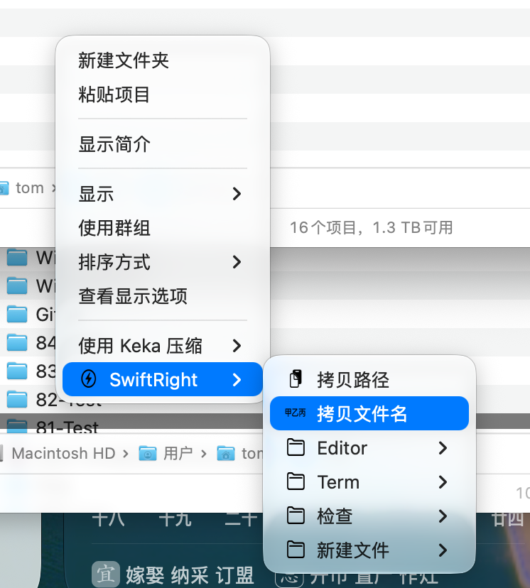
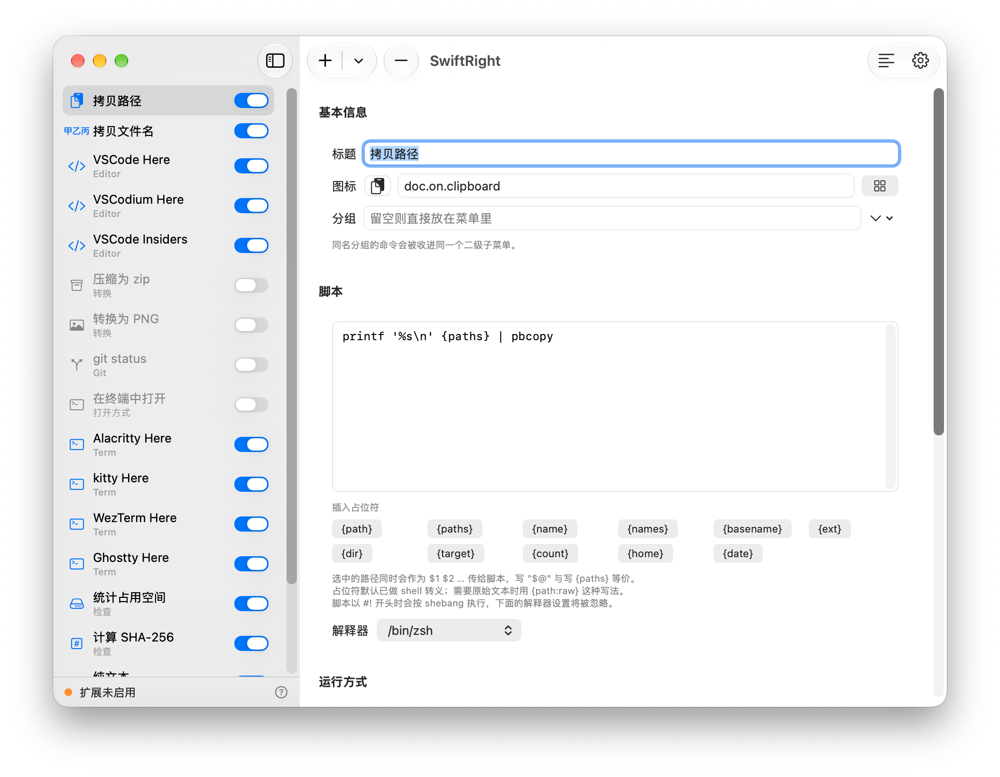

# SwiftRight

[English](README.md)

> 由 Claude Opus 5 Vibe Coding 而成。

macOS 访达（Finder）右键菜单扩展。在图形界面里定义任意 shell 命令，它们会立刻出现在右键菜单中，作用于当前选中的文件。

用 Swift / SwiftUI / Xcode 构建，无第三方依赖。





---

## 安装

### 用发布版

从 [Releases](https://github.com/whynbnb/SwiftRight/releases) 下载 `SwiftRight-<版本>.dmg`（或 `.zip`），把 **SwiftRight.app** 拖进**应用程序**，然后：

```bash
xattr -dr com.apple.quarantine /Applications/SwiftRight.app
```

**这条命令不是可选的。** 发布版是 ad-hoc 签名、未经公证的——原因和不执行的后果见下面的 [Gatekeeper](#gatekeeper)。

### 从源码构建

```bash
swift Scripts/make-icon.swift   # 可选：生成 App 图标
./Scripts/build.sh              # 生成工程 → 编译 → 安装到 /Applications → 注册扩展
```

本地构建的产物用你自己的证书签名、也不会被打隔离标记，不需要 `xattr` 这一步。

只编译不安装：`./Scripts/build.sh build`
打分发产物：`./Scripts/package.sh` → `dist/`（zip + dmg，ad-hoc 签名）
在 Xcode 里开发：`open SwiftRight.xcodeproj`（工程文件已入库，只有需要重新生成时才用得上 `xcodegen`）

### 两种方式都要做的

1. 打开一次 `/Applications/SwiftRight.app`
2. **系统设置 › 通用 › 登录项与扩展 › 访达扩展**，勾选 **SwiftRight**
3. 在访达里右键任意文件

默认情况下 App 常驻菜单栏（不占 Dock）。点菜单栏图标 → **管理命令…** 打开编辑器。

**需要让 App 一直挂后台吗？** 不需要。访达扩展是独立进程，直接读配置；点菜单项时 LaunchServices 会按需拉起主 App——实测冷启动约 0.29 秒、热启动约 0.18 秒。不想让它常驻的话，**设置 › 通用 › 后台常驻**里有「用完自动退出」。唯一的硬性要求是安装后打开一次 App，让它写出初始配置。

---

## Gatekeeper

发布版是 **ad-hoc 签名、未经公证**的，所以 macOS 会给下载到的包打上隔离标记并拒绝打开：

> 「SwiftRight」已损坏，无法打开。

这个提示有误导性——**没有任何东西损坏**。凡是带隔离标记又没有 Developer ID 签名的 App，Gatekeeper 都是这句话。去掉标记即可：

```bash
xattr -dr com.apple.quarantine /Applications/SwiftRight.app
```

不做这一步还会让访达扩展**静默失效**：带隔离标记的 bundle 根本不会被系统登记，于是右键菜单什么都不出现，系统设置里也找不到可勾选的项。

通过 AirDrop、U 盘、局域网共享传过来的文件不会被打隔离标记，那些副本直接就能开。

**为什么不干脆公证？** 公证需要付费的 Apple Developer Program 会员（每年 $99）才能拿到 Developer ID 证书。在那之前 ad-hoc 是诚实的替代方案，而且它比用开发证书签名还多一个好处：**ad-hoc 没有证书，也就不会过期**。开发证书有效期一年，而 Xcode 只在 Developer ID 签名时才向苹果时间戳服务器申请安全时间戳，所以开发证书签出来的二进制一旦证书到期，签名就不再通过校验。

---

## 架构

```
访达 ──右键──▶ FinderExtension.appex  （沙盒）
                     │  读 commands.json 拼菜单
                     │  点击后写一张凭据，open swiftright://run?ticket=…
                     ▼
              SwiftRight.app          （非沙盒）
                     │  查凭据 → 展开占位符 → Process 执行
                     ▼
              后台 / 输出窗口 / 终端
```

**为什么要拆成两个进程？**

app extension 被系统强制沙盒，在扩展里 `Process` 起不了任何外部程序 —— 而"执行用户自定义命令"恰恰就是这个工具的全部意义。所以扩展只做菜单，执行放在非沙盒的主 App 里。

两边通过 `~/Library/Application Support/SwiftRight/` 通信：

| 文件 | 用途 |
|---|---|
| `commands.json` | 命令定义。App 写，扩展只读（按 mtime 缓存，改完立即生效，不用重启访达） |
| `pending/<uuid>.json` | 一次性调用凭据。扩展写，App 读完即删 |
| `scratch/` | 终端模式生成的临时 `.command` 脚本 |

扩展靠 `temporary-exception.files.home-relative-path.read-write` 拿到这一个目录的读写权限，范围精确到 SwiftRight 自己的目录。**没有用 App Group**，因此不依赖付费开发者账号。

路径走文件而非塞进 URL：多选几十个长路径容易把 URL 撑爆，路径里的特殊字符做百分号编码也容易出错。

`Shared/` 下的匹配逻辑同时编译进两个 target，菜单显示条件与实际执行条件因此永远一致 —— 不会出现"菜单里有但点了没反应"。

---

## 占位符

占位符**默认已做 shell 单引号转义**，路径含空格、引号、`$` 都不会出问题。需要原始文本时加 `:raw`（例如 `{paths:raw}`）。

| 占位符 | 含义 |
|---|---|
| `{path}` | 第一个选中项的完整路径 |
| `{paths}` | 全部选中项，空格分隔 |
| `{name}` | 文件名（含扩展名） |
| `{names}` | 全部文件名 |
| `{basename}` | 文件名（不含扩展名） |
| `{ext}` | 扩展名，不含点 |
| `{dir}` | 所在文件夹 |
| `{target}` | 当前访达窗口对应的文件夹 |
| `{count}` | 选中项数量 |
| `{home}` | 用户主目录 |
| `{date}` | 时间戳 `yyyyMMdd-HHmmss` |

选中的路径**同时**作为位置参数传入，所以下面两种写法等价：

```bash
zip -r out.zip {paths}
zip -r out.zip "$@"
```

还有一组环境变量：`SR_PATH` `SR_PATHS`（换行分隔）`SR_DIR` `SR_TARGET` `SR_NAME` `SR_BASENAME` `SR_EXT` `SR_COUNT` `SR_HOME`。

脚本以 `#!` 开头时，会被写成临时可执行文件按 shebang 执行，命令里配置的解释器被忽略 —— 可以直接写 Python、Ruby、AppleScript。

GUI 进程继承到的 `PATH` 通常很窄，执行前会自动补上 `/opt/homebrew/bin` 和 `/usr/local/bin`，brew 装的工具能直接用。

---

## 命令选项

- **运行方式** — 后台静默 / 显示输出窗口（实时流式 stdout+stderr）/ 在终端中运行
- **工作目录** — 选中项所在文件夹 / 选中的文件夹本身 / 当前访达窗口 / 自定义（支持占位符）
- **适用范围** — 仅文件 / 仅文件夹 / 都行，可再按扩展名过滤；不满足条件的命令直接不出现在菜单里
- **分组** — 同名分组自动收成二级子菜单
- **每项单独运行** — 多选时对每个文件各起一个进程，而不是一次性全传进去
- **执行前确认** / **完成后通知** / **超时**（秒，0 为不限）
- 全局可切换：命令平铺在右键菜单顶层，还是收进一个二级菜单

编辑器里的**试运行**会弹出文件选择器让你挑几个文件当作"选中项"，立刻跑一次并显示输出 —— 不用切到访达反复试。

后台命令失败时默认自动弹出输出窗口，否则静默失败很难排查（可在设置里关掉）。

---

## 生成器

工具栏的 `+` 菜单和设置窗口都能帮你批量生成命令。

**终端。** 扫描本机终端，生成「在此处打开 kitty」这类命令。各家终端的命令行约定完全不同，所以内置了启动配方，参数都照着各自的 `--help` 核实过：

| 终端 | 参数 |
|---|---|
| Terminal / iTerm2 | `open -a <App> <脚本>` |
| kitty | `--directory {dir} {shell} {script}` |
| WezTerm | `start --cwd {dir} -- {shell} {script}` |
| Ghostty | `--working-directory={dir} -e {shell} {script}` |
| Rio | `--working-dir {dir} -e {shell} {script}` |
| Alacritty | `--working-directory {dir} -e {shell} {script}` |

内置清单之外的发现，按 `CFBundleTypeRole == "Shell"` 过滤 —— 那是应用在声明"我**执行**这类文件"。直接问 LaunchServices"谁能打开 shell 脚本"会把 Chrome、备忘录、Pages 和一堆文本编辑器全捞进来。

kitty、WezTerm、Ghostty、rio 在命令退出时会连窗口一起关掉，短命令基本一闪而过。**命令结束后保持终端打开**（默认开）会在末尾接一个交互式 shell 并打印退出码。

**编辑器。** 扫描本机编辑器，生成「在此处打开 Zed」这类命令。和终端不同，编辑器不需要 per-app 配方 —— `open -b <bundle id> <路径>` 对所有 GUI 编辑器都成立，而且按 bundle id 打开，应用升级搬家都不会失效。

真正需要逐个记录的只有一件事：能不能把文件夹当工程打开，它决定生成的命令对文件夹生不生效。这一点不能从 `Info.plist` 读：VS Code、Zed、VSCodium 确实声明了 `public.folder`，但 JetBrains 全家和 Qt Creator 都没声明，实际却完全支持。

**文件模板。** 右键文件夹 → **新建文件 ▸** 选模板，对标 Windows 资源管理器的「新建」。内置纯文本、Markdown、JSON、HTML、CSS、JavaScript、YAML、XML、Shell 脚本、Python，后两个自动加可执行位。名称、默认文件名、扩展名、图标、初始内容都能改，也可以自己加。

生成的命令是一段带 heredoc 的普通脚本，随时看得懂改得动。重名按访达的习惯递增（`未命名 2.md`）。建完会在访达里选中新文件，按 Return 即可改名。

---

## 设置

从菜单栏图标打开，或按 ⌘,

- **通用** — 语言（跟随系统 / 简体中文 / English，即时生效）、主题（跟随系统 / 浅色 / 深色）、后台常驻方式、后台命令失败时是否自动弹出输出窗口
- **菜单** — 右键菜单外观
- **终端** — 扫描、手动添加、选默认、逐项调启动参数、单项测试、命令结束后是否保持终端打开
- **编辑器** — 扫描、手动添加、切换是否可开工程、加到菜单
- **新建文件** — 管理模板
- **配置** — 导出 / 导入（追加或替换）、文件位置、恢复示例
- **扩展** — 状态与排查

### 后台常驻

访达扩展被强制沙盒、起不了外部进程，所以必须有个非沙盒进程来执行命令。「不常驻」也就等于「每次冷启动」，没有第三条路。**设置 › 通用 › 后台常驻**决定你落在这个取舍的哪一头：

| 模式 | 菜单栏图标 | 响应 | 是否留进程 |
|---|---|---|---|
| **常驻菜单栏**（默认） | 有 | 最快 | 是 |
| **常驻但隐藏图标** | 无 | 最快 | 是 |
| **用完自动退出** | 无 | 慢约 0.08 秒 | 否 |

「用完自动退出」会等到没有命令在跑、也没有窗口开着才退出，所以长时间的后台命令不会被中途掐断。

隐藏图标之后，要打开界面就双击「应用程序」里的 SwiftRight。

---

## 常见问题

**右键菜单里什么都没有**

1. 如果装的是发布版，隔离标记去掉了吗？带标记的 bundle 根本不会被登记——见 [Gatekeeper](#gatekeeper)
2. App 是否在 `/Applications` 且至少打开过一次 —— 系统只登记这样的扩展
3. 系统设置里是否勾选了 SwiftRight（App 侧边栏底部有实时状态灯）
4. `killall Finder`

侧边栏底部的 **?** 按钮会跳到同样的排查工具。

**改了命令要重启访达吗**

不用。扩展每次右键都会检查 `commands.json` 的修改时间。

**签名**

`project.yml` 里的 `DEVELOPMENT_TEAM` 需要换成你自己的 Team ID：

```bash
security find-identity -v -p codesigning
```

注意证书通用名括号里那十位是**证书** ID，不是 Team ID，要看 `OU` 字段。

---

## 目录结构

```
project.yml                  XcodeGen 工程定义（.xcodeproj 也已入库）
Shared/                      App 与扩展共享的代码
  SRCommand.swift              命令模型 + 菜单匹配逻辑
  SRConfigStore.swift          commands.json 读写 + 内置示例
  SRPaths.swift                绕开沙盒容器的真实路径
  SRPlaceholder.swift          占位符展开 + shell 转义
  SRTicket.swift               扩展 → App 的一次性调用凭据
App/                         主 App（非沙盒）
  SwiftRightMain.swift         入口、菜单栏、URL 回调、后台常驻方式
  SRCommandRunner.swift        Process 执行、环境、超时、终端模式
  SRRunSession.swift           单次执行的可观察状态 + UTF-8 增量解码
  SRAppModel.swift             界面数据源与命令生成器
  SRPreferences.swift          语言 / 主题 / 常驻方式 / 本地化
  SRWindowManager.swift        窗口与 .accessory ⇄ .regular 激活策略
  SRTerminal*.swift            终端清单与启动配方
  SREditor*.swift              编辑器清单
  SRFileTemplate.swift         新建文件模板
  SRTemplateStore.swift        模板持久化
  Views/                       SwiftUI 界面，含设置窗口与关于窗口
FinderExtension/             访达扩展（沙盒）
  FinderSync.swift             监视范围、菜单构建、点击转发
Scripts/
  build.sh                     编译 → 安装到 /Applications → 注册扩展
  package.sh                   编译 → ad-hoc 重签 → dist/ 下的 zip 与 dmg
  make-icon.swift              生成 App 图标
```

---

## 开源协议

[MIT](LICENSE)
